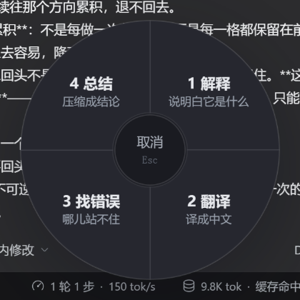
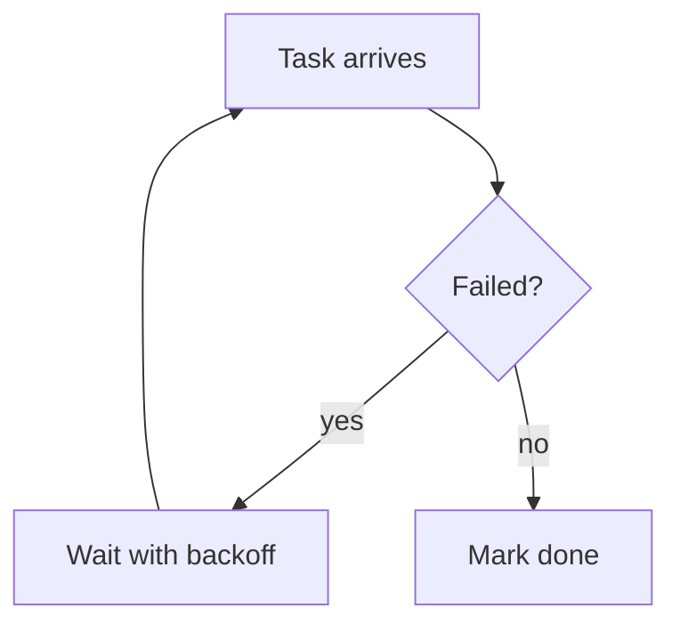

# dsh-eli5 — plain words

**[English](README.md) · [中文](README.zh.md)**


Select a word, a sentence, a piece of code or an error message in the DSH Web UI, click the `✦`, and pick one of four actions from the wheel. A side panel answers in the plainest words it can, and you can keep asking follow-ups. When the answer depends on the repository, it reads the conversation's workspace **read-only** and shows exactly what it opened under "looked at".

The name is Explain Like I'm 5, but the point is not baby talk: the first line has to be plain speech — "this thing is …" — with no unexplained jargon, and any term that must appear gets translated on the spot. No guessing, no jargon padding, no restating your question.

The other reason it exists: **it never touches the main conversation**. Answers come from a separate auxiliary model call; nothing is appended to the Session, so the turn count, token usage and compaction threshold of the conversation you are reading do not move.

## Two paths

| | Main conversation | dsh-eli5 |
|---|---|---|
| Entry | you send from the composer | select text → click `✦` → pick an action (or `Ctrl/⌘+Shift+E` to explain directly) |
| Goes to | Agent loop → Session log → next request's context | `POST /eli5/ask` → an independent `ctx.llm.prepareCall` query (plus a few read-only tool rounds when needed) |
| Messages | system prompt + full history + tool definitions | fixed system prompt + one user message (+ the panel's own tool rounds) |
| Sees | the whole session | **the conversation on your screen** (an excerpt read from the DOM) + the selection + the panel's own turns + read-only files under the session cwd |
| Result lands in | Session events (compacted, counted) | browser memory only (plus an 80-entry in-process cache on the host) |
| Effect on context | grows every turn | **none** |

Requests never write to Session storage. The only external things they read are the excerpt of the conversation visible on your screen and the files of that session's workspace. Both are sent once and discarded; neither is written back.

The cost is worth stating too: explanations are billed against the configured model; panel history is not persisted and dies with the page or the host process (an identical selection with no tool use hits the in-process cache instead of paying twice).

## The wheel

Selecting text floats a small `✦` dot next to the selection. Click it and the menu grows out of the dot: four sectors, each with a one-line hint.



| Action | What it does | Reads the workspace |
|---|---|---|
| Explain | says what the thing is, in plain words (the original behaviour) | yes |
| Translate | renders it in Chinese, keeping code, paths and identifiers verbatim | no |
| Find mistakes | states "wrong / not wrong / not enough evidence" first, then points at each problem | yes |
| Summarize | one-line conclusion plus at most three points you can carry away | no |

Keyboard: `1`–`4` pick directly, `Esc` or the hub cancels, clicking elsewhere dismisses. The panel title becomes the action name, and follow-ups stay inside that action — asking "why is it translated this way" in Translate asks about the translation.

The last column is a whitelist: reading a repository adds nothing to a translation or a summary, so those two never mount tools and never spend a few extra seconds looking for "more accuracy".

## Reading the workspace (read-only)

The same word means different things in different conversations, and the same symbol behaves differently in different repositories. The model therefore gets three **read-only** tools:

| Tool | Purpose |
|---|---|
| `read_file(path, startLine?, endLine?)` | reads a text file with line numbers, at most 400 lines per call |
| `grep(pattern, glob?, maxResults?)` | regex search, returns `path:line:content`, 40 results by default |
| `glob(pattern)` | lists files by glob (at most 100) |

The boundary is code, not prompt text:

- **Root = the session's cwd** (read once from the Session header). Anything outside it is refused: `../`, absolute paths, symlinks pointing out.
- `.env*`, `*.pem`, `*.key`, `id_rsa*`, `.npmrc` and friends are refused; `.git`, `node_modules`, `.venv`, `dist` are not entered.
- **Budgets are fixed, not left to the model**: at most 3 tool rounds, 6 calls, 200 KB read and 60 s in total. When a budget runs out, the model receives "budget exhausted, answer from what you have" as a tool result and must wrap up.
- A single tool result over 12 KB is truncated; `grep` also caps its scan at 800 files / 8 MB so it cannot spin inside a large repository.
- Resolution failures, missing files and exhausted budgets never throw at the browser: they become a line of text the model can read, so **it cannot pretend it read something**.

The panel shows "looked at · N succeeded" with one line per call (`read internal/worker/retry.go`, `search /RetryPolicy/`), failures in red; the block is hidden when nothing was read.

When reading is worth it is constrained by the prompt: answer first, read only when the selection alone cannot settle the question (behaviour of code, a definition in this repository, "where is this implemented"), one or two files at most, and cite evidence as `path:line`.

## Diagrams

When the subject is a **flow, a hierarchy, a state machine or a comparison**, the model may draw a ```mermaid``` diagram that the panel renders to SVG:




The renderer is in-house ([lib/mermaid-lite.js](lib/mermaid-lite.js)) and is **not** full Mermaid:

- only `flowchart` / `graph` (with `TD`, `LR`, …), boxes `[ ]`, rounded `( )`, diamonds `{ }` and labelled arrows `-->|text|`, up to 24 nodes;
- no subgraph, style, classDef, sequence/gantt diagrams or animation — the prompt forbids them;
- an unparsable diagram keeps its source and adds a "could not draw this" line instead of showing a broken picture;
- layout is layered: cycles become dashed edges that loop back outside (the "try again → task failed" edge above), and long edges detour around intermediate nodes instead of crossing them. The panel is a narrow column, so the prompt prefers top-down `TD`; diagrams slightly wider than the panel are scaled down, much wider ones scroll;
- everything is escaped before it reaches the SVG — model output has no HTML injection surface. The renderer is loaded by the host only when the first diagram appears (`/eli5/mermaid-lite.js`).

Why not real Mermaid: it is a 3 MB runtime and this plugin has zero runtime dependencies. That is a bad trade for "three boxes and two arrows"; switch when the subset stops being enough.

## What an answer looks like

Three hard rules, written into the system prompt as rules rather than suggestions:

1. **Fixed opening**: "this thing is …" — what it is and what it is for, in words a newcomer can follow. No unexplained term in that first line.
2. **Terms translated in place**: when one must appear, the plain meaning follows in parentheses (`idempotent (running it twice leaves the same state as running it once)`).
3. **No process narration**: no "let me search first" — the reading trace already shows that.

Example:

> **This is the "you can only go forward, you cannot go back" phenomenon.** The ratchet (a gear that turns one way and jams the other) gives it the name…
>
> The key point: one-directional and irreversible — that is what separates it from "fluctuation" or "cycle".

## The context excerpt (and why it still does not pollute the session)

The same word means something else in another conversation. Selecting `agent` while reading about your own Go service is not a question about generic AI agents.

So the request carries **an excerpt of the conversation on your screen**: about 2400 characters before the selection and 600 after, taken from the transcript's own scroll area. The model leans on the conversational meaning first and falls back to the generic one only when the excerpt has no clue — and says so when it does.

The key difference: that text is **read from the page DOM**, not from the Session log. It is sent once and discarded; it never changes the conversation's length or order. What it sees is what you can see.

Whether it is attached is decided at click time, not by a switch: a selection **inside the transcript** gets the excerpt, a selection elsewhere (headings, sidebars, standalone paragraphs) only gets the text around it. A switch would cost a permanent control plus a re-run to undo a choice — more than the tokens it saves. Set `maxContextChars` to `0` to remove the capability entirely.

## Usage

- **Select text** → click the `✦` next to it → choose an action (`1`–`4` also work)
- or select and press `Ctrl+Shift+E` (`⌘+Shift+E` on macOS) to explain directly
- panel input: `Enter` to ask, `Shift+Enter` for a newline, `Esc` to close
- after the first answer, quick follow-ups: plainer / example / draw it / why says so / in context
- the citation card at the top names the source (`from · this conversation` / `from · page`); **Merge back** puts the conclusion into the composer
- "looked at" lists what this answer read or searched; click the title to collapse
- "Stop" in the header cancels mid-stream: the partial answer stays with "stopped, answer incomplete"; closing the panel aborts the request too
- hitting the output limit is reported as such instead of pretending to finish; an identical selection replayed from cache says it did not call the model
- "Copy" gives plain Markdown
- selections over 4000 characters are refused (that is no longer "a word" — ask the main conversation instead)

## Merging back into the conversation

No need to re-ask the main conversation. **Merge back**, on the citation card:

- selection from the conversation → a quote node with the original text goes into the composer first, followed by this answer's conclusion;
- selection from elsewhere → only the conclusion, since there is no conversation text to quote.

What lands is a **draft**; nothing is sent. Edit it or delete it. The conclusion is the first paragraph plus at most three bullets — no extra model call.

Insertion goes through the official composer `inputActions` (`insertQuote` / `insertText`). If the host has no writable session, or the UI version does not publish those verbs, it falls back to copying to the clipboard and says so in the panel — it never silently drops the content.


## Layout

| File | Purpose |
|---|---|
| `lib/index.js` | Cordis entry: registers the `webServer` routes |
| `lib/service.js` | explanation service: route resolution, request validation, tool budget, model call, cache, concurrency cap |
| `lib/tools.js` | the three read-only tools and their sandbox (cwd boundary, denylist, size and scan caps) |
| `lib/prompt.js` | per-action system prompts (preamble, diagram allowance, tool allowance) + user message assembly |
| `lib/http.js` | `GET /eli5/health`, `POST /eli5/ask` (SSE: `meta` / `text` / `trace` / `notice` / `done` / `error`) |
| `lib/config.js` | config normalisation and defaults |
| `lib/client.js` | browser half: selection detection, wheel, panel, trace, merge (hand-written bundle, no React) |
| `test/host.test.mjs` | host unit checks (sandbox escapes, tool loop, actions) |
| `test/ui-smoke.mjs` | browser smoke driven over CDP (see below) |

The host half has **zero runtime dependencies** (`node:crypto`, `node:fs`, `node:path` only) and the browser half uses DOM APIs only, so the package can live outside the profile and be installed with `link:` without bare-specifier resolution failures.

## Install (web profile)

```sh
# 0) from npm (once published): dsh plugin --profile web add dsh-eli5
# 1) make the package resolvable from the profile
ln -sfn ~/.dsh/plugins/dsh-eli5 ~/.dsh/profiles/web/node_modules/dsh-eli5

# 2) register it in ~/.dsh/profiles/web/package.json dependencies (recommended,
#    so a later pnpm install does not drop the link)
#    "dsh-eli5": "link:../../plugins/dsh-eli5"

# 3) append to ~/.dsh/profiles/web/cordis.patch.yml
```

```yaml
- insert:
    - id: eli5
      name: dsh-eli5
      config:
        provider: fancyhub
        model: deepseek-flash
```

**Hot reload boundaries**: the browser half (`lib/client.js`) and the diagram renderer (`lib/mermaid-lite.js`) are served from disk per request — save and refresh the page.

**The host half** (`lib/index.js`, `service.js`, …) is imported at process start, so changes need a restart — unless you mount `@deepseek-ai/dsh-hmr` in the profile and add this package as a watched root:

```yaml
- id: hmr
  config:
    root:
      - /absolute/path/to/dsh-eli5        # default root is empty (profile config only)
```

The cost: a reload disposes and re-applies the plugin — **in-flight explanations are interrupted and the in-process cache is cleared**; a half-saved syntax error does not take the plugin down (that reload fails, the previous version keeps serving, the next good save switches over).

**The hmr entry itself needs no restart**: the profile config is already inside the config watcher, and the new `root` rides the recomposition (measured: after adding `root`, editing `PROMPT_REVISION` changed the reported prompt version without restarting). The default `ignored` includes `**/node_modules`, so `root` must point at the real source directory, not at a symlink under `node_modules`.

Restarting ends running conversations (the session records survive).

Uninstall: remove the insert, remove the symlink, restart.

## Browser smoke

`test/ui-smoke.mjs` drives a headless Chrome that exposes `--remote-debugging-port=9222`: it opens the GUI, waits for `window.__dshEli5`, opens the panel once through the debug handle, clicks a quick follow-up, opens the wheel through a real DOM selection, picks an action, merges the answer back, screenshots along the way and reports page exceptions at the end.

```sh
node test/ui-smoke.mjs 'http://127.0.0.1:<port>/?token=<token>'
```

It connects to `http://127.0.0.1:9222`, so it is for local debugging only. Start a throwaway instance first (not the one you are using) and close Chrome afterwards.

## Configuration

Edit the `config` block in the patch; changes apply on the next request:

| Key | Default | Meaning |
|---|---|---|
| `provider` / `model` | `fancyhub` / `deepseek-flash` | blank means auto (prefers fancyhub's small model) |
| `maxOutputTokens` | 1200 | output cap per turn |
| `timeoutMs` | 90000 | end-to-end timeout, tool rounds included |
| `temperature` | unset | model default; term explanations rarely need divergence |
| `maxSelectedChars` | 4000 | larger selections get a 413 |
| `maxContextChars` | 4000 | excerpt budget (`0` disables the excerpt) |
| `cacheEntries` | 80 | in-process cache entries (answers that used tools are not cached) |
| `maxConcurrent` | 4 | concurrent explanations; beyond this returns 429 |
| `enableTools` | `true` | master switch; off means pure auxiliary query, no files |
| `maxToolRounds` | 3 | tool round trips per explanation |
| `maxToolCalls` | 6 | tool calls per explanation |
| `maxToolBytes` | 200000 | cumulative `read_file` bytes |
| `maxToolMs` | 60000 | total time spent in tools |
| `maxFileLines` | 400 | lines per `read_file` |
| `maxGrepResults` | 40 | `grep` results (the model may ask for up to 80) |
| `maxGlobResults` | 100 | `glob` results |
| `debug` / `debugCwd` | `false` / `''` | isolated-instance testing: pins the tool root to one directory |

## HTTP API

```sh
GET  /eli5/health   → {"ok":true,"provider":"fancyhub","model":"deepseek-flash","listed":true,"tools":true}
POST /eli5/ask      → text/event-stream; body: {action?, text, question?, context?, history?[], sessionId?}
```

SSE events:

| Event | Payload |
|---|---|
| `meta` | `{provider, model, cached, tools, prompt}` — always first (headers are withheld until the first real event, see below) |
| `text` | `{text}` answer fragment |
| `trace` | `{tool, target, ok, ms, reason?}` one tool call |
| `notice` | `{text}` user-facing note (stopped, truncated, cached replay) |
| `done` | `{cached}` |
| `error` | `{message}` failure after the stream started |

A failure before the stream starts is JSON `{ok:false,error}` with a 4xx/5xx. `meta` is deliberately held back until the first real event so that "the model route failed immediately" can still return a proper status instead of `200` plus an empty stream.

Response headers `x-eli5-model` / `x-eli5-prompt` identify the actual route and prompt revision.

`action` is one of `explain` / `translate` / `critique` / `summarize`; anything else falls back to `explain`. It is part of the cache key, because two actions over the same selection produce the same user message but different system prompts.

## Host surface

| Item | Content |
|---|---|
| Services registered | none (no `ctx.provide`) |
| Events emitted | none (no `ctx.emit`) |
| Dependencies | `webServer` (routes after `ctx.inject`), `timer` (`ctx.timeout` for the request deadline, cleaned up with the fiber), `llm` (fetched per request, no held handle) |
| Public surface | two HTTP routes + one browser bundle (`./client`) |

Exposing nothing is deliberate: the whole capability is one route, and no other plugin should or can reuse it.

## Known limits

- Web only (`dsh.client.platform: web`); the TUI and desktop shells have no such DOM.
- Panel history lives in the page; reuse across pages is the host's in-process cache, which dies with the host.
- The tool root is the **cwd at session creation**: a session that later `cd`ed, or a subagent in another directory, still explains against the original one.
- Reading files only happens when it is needed, but it still costs time: a first answer takes 4–5 s, with file reads commonly 8–20 s. The trace is what fills those seconds.
- Answers that used tools are not cached (the same question may differ with the file state); only pure explanations are.
- Selection detection covers any selectable page text; selections inside inputs are ignored. If a first-party selection toolbar ever occupies the same spot, the panel offset has to move.
- The excerpt covers roughly 4000 characters around the selection; a definition that appeared a dozen turns earlier will not be included automatically — select it together with the question.

## Debug

`window.__dshEli5` is the browser-side debug handle:

```js
__dshEli5.open('棘轮效应', 'optional context')  // open the panel without selecting
__dshEli5.close()
```

In an isolated instance (`debug: true` + `debugCwd: <dir>` in the patch) the route can be exercised with curl, no browser needed:

```sh
curl -sN -X POST http://127.0.0.1:3099/eli5/ask \
  -H 'content-type: application/json' \
  -d '{"text":"RetryPolicy","context":"we are adding retries to a background worker"}'
```
