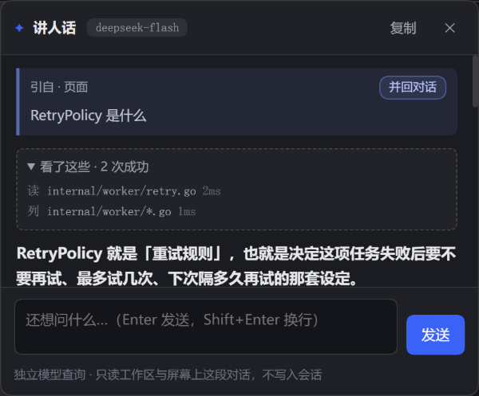
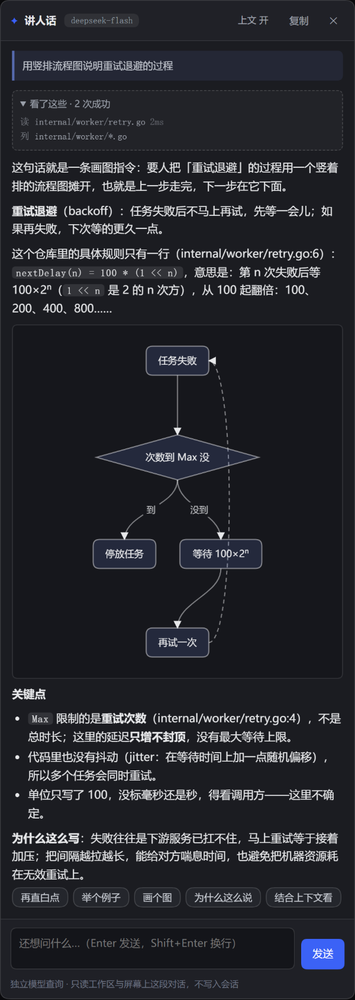
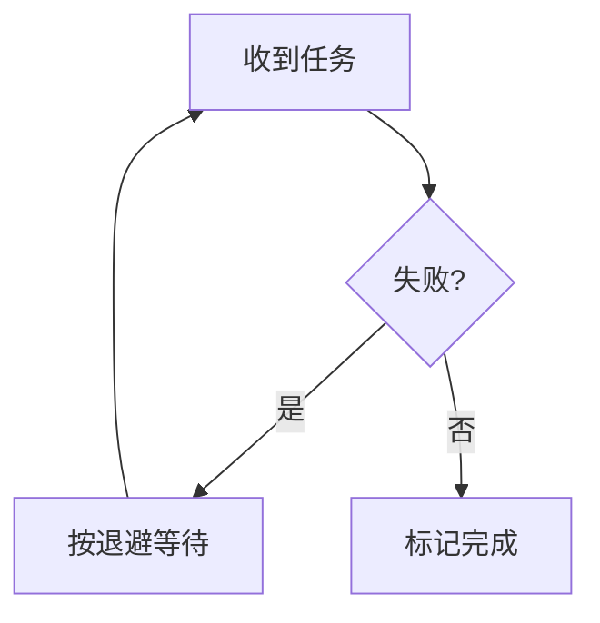
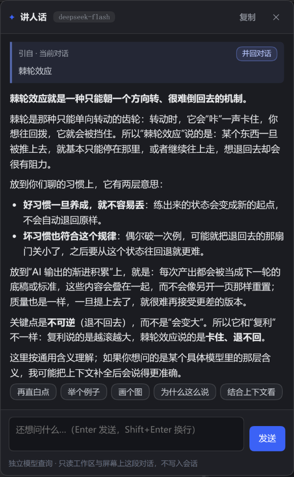

# dsh-eli5 — 讲人话



在 DSH 的 Web 界面里选中看不懂的词、句子、代码或报错，点浮出来的「讲人话」，右侧浮层用**最直白、最不绕弯子**的话说明白它是什么；不懂可以接着追问。需要看代码才能说清时，它会**只读**地翻一下会话所在的工作区，并在浮层里留下「看了这些」。

名字取 Explain Like I'm 5：不是把人当小孩，而是要求**第一行就是大白话**——「这东西就是……」，不先抛术语；术语必须出现时当场翻译。它不猜、不堆黑话、不复述问题。

它存在的另一个理由是**不污染主对话**：回答走一条独立的辅助模型查询，不写任何 Session 记录，主对话的轮次、token 和压缩阈值都不受影响。

## 两条链路

| | 主对话 | 讲人话 |
|---|---|---|
| 入口 | 你在输入框发送 | 点「讲人话」或 `Ctrl/⌘+Shift+E` |
| 去向 | Agent 循环 → Session 日志 → 下一次请求的上下文 | `POST /eli5/ask` → `ctx.llm.prepareCall` 的独立查询（必要时几轮只读工具调用） |
| 消息构成 | 系统提示 + 全部历史 + 工具定义 | 固定 system prompt + 一条 user 消息（+ 浮层自己的工具往返） |
| 看得到什么 | 完整会话 | **屏幕上你正在读的那段对话**（节选，只读页面文字）+ 选中的文字 + 浮层里自己的几轮问答 + 会话工作区的只读文件 |
| 结果落点 | Session 事件（会被压缩、会计入 token） | 只在浏览器内存里（Host 侧另有 80 条进程内缓存） |
| 对上下文的影响 | 每一轮都变长 | **零** |

解释请求**不写** Session 存储。它只读两样外部东西：页面 DOM 上你看得见的对话节选，和会话工作区里的文件。两者都随请求发一次、用完即弃，不会写回会话。

代价也说清楚：解释按配置的模型单独计费；浮层历史不落盘，Host 重启或页面刷新后消失（同一段文字、没有读文件时，进程内会命中缓存，不重复付费）。

## 它能在工作区里读文件（只读）

同一个词在不同对话里含义不同，同一个符号在不同仓库里行为也不同。所以模型手上有三个**只读**工具：

| 工具 | 作用 |
|---|---|
| `read_file(path, startLine?, endLine?)` | 带行号读一个文本文件，一次最多 400 行 |
| `grep(pattern, glob?, maxResults?)` | 正则搜索，返回 `路径:行号:内容`，默认最多 40 条 |
| `glob(pattern)` | 按 glob 列文件（最多 100 条） |

边界不是靠提示词，是靠代码：

- **根目录 = 当前会话的 cwd**（从 Session 头只读取一次）。不在这个根目录下的路径一律拒绝，`../`、绝对路径、指向外面的符号链接都算。
- 拒绝读 `.env*`、`*.pem`、`*.key`、`id_rsa*`、`.npmrc` 这类文件；不进入 `.git`、`node_modules`、`.venv`、`dist` 等目录。
- **预算写死，不交给模型**：最多 3 轮工具往返、6 次调用、累计读 200KB、总时长 60 秒。超了就把「预算已用完，请基于已有信息回答」作为工具结果回给它，强制收尾。
- 单次工具结果超过 12KB 会截断；`grep` 另有 800 个文件 / 8MB 的扫描上限，避免在大仓库里空转。
- 路径解析失败、文件不存在、超预算都不会抛给浏览器，而是变成模型能读到的一行说明——**它不会假装读过**。

浮层顶部会出现「看了这些 · N 次成功」，展开是每一行 `读 internal/worker/retry.go` / `搜 /RetryPolicy/`，失败的读用红色标出来。没有读文件时这块整个隐藏。

什么时候值得读，由提示词约束：**先直接解释**，只有当选中文字本身不足以判断（代码行为、仓库里的定义、"它到底在哪实现"）时才读，且 1–2 个文件为限。引用依据要写成 `路径:行号`。

## 会画图（Mermaid 子集）

当内容涉及**流程、层级、状态转换、方案对比**时，模型可以直接用 ```mermaid 画一张图，浮层里渲染成 SVG：





渲染器是自带的 [lib/mermaid-lite.js](lib/mermaid-lite.js)，**不是**完整的 Mermaid：

- 只认 `flowchart` / `graph`（`TD`、`LR` 等方向），方框 `[ ]`、圆角 `( )`、菱形 `{ }`、带文字箭头 `-->|文字|`，节点上限 24；
- 不认 subgraph、style、classDef、时序图、甘特图、动画——这些在提示词里就被禁止了；
- 解析不了就**保留原始定义 + 一行“图画不出来”**，不会显示一张坏图；
- 布局是分层排的：环会画成绕回起点的虚线（上图「再试一次 → 任务失败」），跨层的边绕到旁边而不是穿过中间那个节点；浮层是窄条，所以提示词让模型优先竖排 `TD`，只比浮层宽一点的图会缩小到装得下，宽太多的才横向滚动；
- 所有文本先转义再进 SVG，模型输出没有 HTML 注入面；渲染器由宿主按需加载（首个图出现时才请求 `/eli5/mermaid-lite.js`）。

为什么不用真正的 Mermaid：它是 3MB 的运行时，而这个插件一直是零依赖；为了“三五个方框加箭头”引入它不划算。子集不够用时再换。

## 输出长什么样

三条硬规则（写在系统提示里，不是建议）：

1. **第一行固定句式**：「这东西就是……」，用外行也听得懂的话说清它是什么、干什么用；第一行不许出现没解释过的术语。
2. **术语就地翻译**：非要出现时，紧跟着括号里说人话（`幂等（同一件事做多少遍，结果都一样）`）。
3. **不叙述过程**：「我先搜一下」「让我看看」这类话不写进答案——读取过程在浮层的「看了这些」里已经显示。

例：

> **这东西就是「只能往一个方向走、退不回去」的现象**。棘轮（一种只能单向转动的齿轮，反向会被卡住）因此得名……
>
> 关键点：单向、不可逆，这是它跟「波动」「周期」的区别。

## 为什么要带上文（以及为什么这仍然不污染对话）

同一个词在不同对话里完全不同。你在聊自己的 Go 服务时选中「agent」，它指的是调度器里的执行器；问一个通用 AI Agent 的定义就没用了。

所以解释请求会附带**你屏幕上那段对话的节选**：从选区所在的对话滚动区里，往回取约 2400 字、往后取约 600 字。模型于是知道「这里在聊 Go 服务里的执行器」，并会优先按对话里的含义讲；对话里没有线索时才退回通用含义，并明说自己是按通用含义解释。

关键区别：这段文字是**从页面 DOM 读出来的**，不是从 Session 日志里取的。它随请求发一次、用完即弃，不会写回会话，也不会改变主对话的长度和顺序——读到的永远只是你自己屏幕上看得见的东西。

选区**落在对话滚动区里**就自动带上文，落在别处（标题、侧栏、独立段落）就只带选区附近的文字。没有开关——「在对话里选一个词」几乎总是想问这段对话，为此常驻一个按钮、再在事后多跑一轮重答，代价比省下的那点 token 更高。想彻底关掉这个能力，把配置里的 `maxContextChars` 设成 0。

## 用法

- **选中文字** → 选区旁浮出 `✦ 解释` → 点击
- 或选中后按 `Ctrl+Shift+E`（macOS 上 `⌘+Shift+E`）
- 浮层底部输入框：`Enter` 追问，`Shift+Enter` 换行，`Esc` 关闭
- 首轮解释完成后出现快捷追问：再直白点 / 举个例子 / 画个图 / 为什么这么说 / 结合上下文看
- 浮层顶部的引用卡写明这段话的来处（引自 · 当前对话 / 引自 · 页面），右侧「并回对话」把结论放回输入框
- 浮层顶部「看了这些」：这次解释看了哪些文件/搜了什么，点标题可折叠
- 回答流到一半想取消，点右上角「停止」：已经出来的部分留着，下面一行注明「已停止，答案不完整」（关掉浮层也会中止请求，不让它白花钱）
- 回答撞到输出上限时不会假装讲完，会补一行「撞到长度上限，后面没写完」；同样的文字刚解释过则直接回放缓存，并注明这次没有重新请求模型
- 「复制」拿到的是纯 Markdown
- 选中超过 4000 字会被拒绝（那已经不是「一个词」了，直接问主对话更合适）

## 并回对话：把结论带回主对话

解释完不用再在主对话里重问一遍。引用卡右侧的「并回对话」会：

- 选区来自对话 → 先在输入框放一个引用节点（原文），再跟上这次解释的结论；
- 选区来自页面别处 → 只放结论，因为没有可引用的对话原文。

放进去的是**草稿**，不会自动发送：想改就改，不想要就删。结论取首段判断 + 最多三条要点，不额外调用模型。

写入走官方 composer 的 `inputActions`（`insertQuote` / `insertText`）。宿主没有可写会话、或界面版本不提供这组动作时，退化成「复制到剪贴板」并在浮层里说明，不会静默丢内容。



## 结构

| 文件 | 作用 |
|---|---|
| `lib/index.js` | Cordis 插件入口：挂 `webServer` 路由 |
| `lib/service.js` | 解释服务：路由解析、请求校验、工具预算、模型调用、缓存、并发上限 |
| `lib/tools.js` | 三个只读工具的实现与沙箱（cwd 边界、黑名单、大小与扫描上限） |
| `lib/prompt.js` | 固定系统提示（含工具使用规则）+ 单条用户消息的组装 |
| `lib/http.js` | `GET /eli5/health`、`POST /eli5/ask`（SSE：`meta` / `text` / `trace` / `done` / `error`） |
| `lib/config.js` | 配置归一化与默认值 |
| `lib/client.js` | 浏览器半边：选区检测、浮动按钮、解释浮层、看了这些（手写 bundle，不依赖 React） |
| `test/host.test.mjs` | 宿主侧单测（含沙箱逃逸与工具循环）：`node --test test/host.test.mjs` |
| `test/ui-smoke.mjs` | 浏览器端冒烟（CDP 驱动 headless Chrome，见下） |

宿主侧**零运行时依赖**（只用 `node:crypto`、`node:fs`、`node:path`），浏览器侧只用 DOM API，因此包放在 profile 之外、用 `link:` 安装也不会因为裸包名解析失败而挂掉。

## 安装（web profile）

```sh
# 0) 从 npm 装（发布后）： dsh plugin --profile web add dsh-eli5
# 1) 让 profile 能解析到包
ln -sfn ~/.dsh/plugins/dsh-eli5 ~/.dsh/profiles/web/node_modules/dsh-eli5

# 2) 在 ~/.dsh/profiles/web/package.json 的 dependencies 里登记（可选，但推荐，避免下次 pnpm install 把链接删掉）
#    "dsh-eli5": "link:../../plugins/dsh-eli5"

# 3) 在 ~/.dsh/profiles/web/cordis.patch.yml 末尾插入
```

```yaml
- insert:
    - id: eli5
      name: dsh-eli5
      config:
        provider: fancyhub
        model: deepseek-flash
```

**热更新的边界**：浏览器半边（`lib/client.js`）和图表渲染器（`lib/mermaid-lite.js`）是每次请求读盘的，存盘后刷新页面即可。

**宿主半边（`lib/index.js`、`service.js` 等）默认是进程启动时 import 的，改动要重启 DSH**——但 DSH 自带 [`@deepseek-ai/dsh-hmr`](https://www.npmjs.com/package/@deepseek-ai/dsh-hmr)，在 profile 的 `cordis.patch.yml` 里给它加一个监听根目录，存盘就会 reload 插件：

```yaml
- id: hmr
  config:
    root:
      - /绝对路径/到/dsh-eli5        # 默认 root 是空的，只监听 profile 配置
```

代价要清楚：reload 会 dispose 再重新 apply 这个插件，**正在进行的解释会中断、进程内缓存清空**；存到一半的语法错误不会把插件弄挂——这次 reload 失败，旧版本继续服务，改好再存就换过去。

**这段配置本身也不用重启**：profile 配置一直在 HMR 的监听范围里，存盘触发重组时就带上了新的 `root`（实测：加上 `root` 后不重启，改 `PROMPT_REVISION` 存盘，接口返回的版本号当场就变了）。默认 `ignored` 含 `**/node_modules`，所以 `root` 要指向真实源码目录，指到 `node_modules` 里的链接不会触发。

重启会结束正在进行的会话（会话记录本身不丢，重开后还在）。

卸载：删掉 patch 里的 insert，删符号链接，重启。

## 浏览器端冒烟

`test/ui-smoke.mjs` 用 CDP 驱动一个开了 `--remote-debugging-port=9222` 的 headless Chrome：打开 GUI、等 `window.__dshEli5` 注册、用调试句柄开一次浮层、点一次快捷追问、再用真实 DOM 选区走一遍「浮出按钮 → 点开 → 出解释」，最后截图并汇总页面里的异常。

```sh
node test/ui-smoke.mjs 'http://127.0.0.1:<port>/?token=<token>'
```

它连接的是 `http://127.0.0.1:9222`，所以只适合在本机调试时用；跑之前先起一个临时实例（别对着正在用的那个），跑完记得关掉 Chrome。

## 换模型 / 调参数

改 patch 里 `config` 的字段，存盘即热生效（配置是每次请求读的）：

| 键 | 默认 | 说明 |
|---|---|---|
| `provider` / `model` | `fancyhub` / `deepseek-flash` | 留空则自动挑（优先 fancyhub 的小模型）。注意 `glm-5.3-flash` 在当前网关余额不足，别选 |
| `maxOutputTokens` | 1200 | 单次解释的输出上限 |
| `timeoutMs` | 90000 | 端到端超时（含工具往返） |
| `temperature` | 未设置 | 不设就用模型默认；术语解释一般不需要发散 |
| `maxSelectedChars` | 4000 | 超过直接 413 |
| `maxContextChars` | 4000 | 附带上文的字数上限（0 = 不带上文） |
| `cacheEntries` | 80 | 进程内缓存条数（用过工具的回答不缓存） |
| `maxConcurrent` | 4 | 同时进行的解释数，超出返回 429 |
| `enableTools` | `true` | 总开关；关掉就退回「纯辅助查询、不碰文件」 |
| `maxToolRounds` | 3 | 最多几轮工具往返 |
| `maxToolCalls` | 6 | 一次解释最多几次工具调用 |
| `maxToolBytes` | 200000 | `read_file` 累计可读字节 |
| `maxToolMs` | 60000 | 工具阶段的总时间 |
| `maxFileLines` | 400 | 单次 `read_file` 的行数上限 |
| `maxGrepResults` | 40 | `grep` 默认返回条数（模型可要求到 80） |
| `maxGlobResults` | 100 | `glob` 结果条数上限 |
| `debug` / `debugCwd` | `false` / `''` | 仅用于隔离实例测试：把工具根目录钉死在一个目录 |

## 接口

```sh
GET  /eli5/health   → {"ok":true,"provider":"fancyhub","model":"deepseek-flash","listed":true,"tools":true}
POST /eli5/ask      → text/event-stream；body: {text, question?, context?, history?[], sessionId?}
```

SSE 事件：

| 事件 | 载荷 |
|---|---|
| `meta` | `{provider, model, cached, tools, prompt}`——总是第一帧（宿主会攒到第一个真实事件才发头，见下） |
| `text` | `{text}` 答案片段 |
| `trace` | `{tool, target, ok, ms, reason?}` 一次工具调用 |
| `done` | `{cached}` |
| `error` | `{message}` 流开始后的失败 |

失败时若还没开流，返回 JSON `{ok:false,error}` 与 4xx/5xx；`meta` 被刻意推迟到第一个真实事件，就是为了让「模型路由直接失败」这种情况还能给出正确的状态码，而不是 200 + 空流。

响应头 `x-eli5-model` / `x-eli5-prompt` 便于确认实际路由与提示词版本。

## 已知限制

- 只有 Web（`dsh.client.platform: web`）。TUI/桌面端没有这块 DOM。
- 浮层历史只活在当前页面里；跨页面复用靠的是宿主进程内缓存，Host 重启即失效。
- 工具根目录是**会话创建时的 cwd**：会话里 `cd` 过、或子代理在不同目录，解释读的仍是原目录。
- 读文件只在「确实需要」时发生，但仍会增加延迟：首答 4–5 秒，涉及读文件常见 8–20 秒。看了这些就是这段时间的去处。
- 用过工具的回答不进缓存（同样的问法在不同文件状态下可能不同），只有纯解释才缓存。
- 选区检测的是「页面上任何可选中的文字」，输入框内的选区会被忽略；如果将来 DSH 自己的选区工具条占了同一个位置，需要挪一下浮层偏移。
- 「上文」取的是选区附近约 4000 字；对话里隔了十几轮才出现的定义不会自动带上——那种情况把定义那段一起选中更稳。

## 调试

浏览器控制台里 `window.__dshEli5` 是调试句柄：

```js
__dshEli5.open('棘轮效应', '可选的上文')  // 不选字也能开浮层
__dshEli5.close()
```

在隔离实例里（patch 里 `debug: true` + `debugCwd: <dir>`）可以用 curl 直接打 `/eli5/ask`，不需要浏览器：

```sh
curl -sN -X POST http://127.0.0.1:3099/eli5/ask \
  -H 'content-type: application/json' \
  -d '{"text":"RetryPolicy","context":"我们在给后台任务加重试"}'
```
